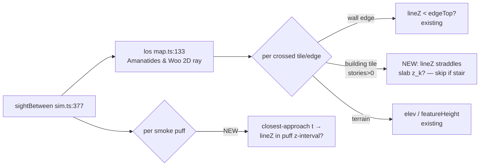

# 3D / Height Simulation Evolution — Implementation Plan

**Date:** 2026-07-23 · **Status:** IMPLEMENTED 2026-07-23 (steps 1–4 landed: 800cb6e, 5951634, a025930, 40d7b14 + grenade wiring 010bab2)
**Builds on:** `docs/plans/2026-07-23-height-rebuild.md` (landed), `docs/decisions/architecture.md` [APPROVED] Height section.

Goal: evolve the landed 2.5D height system toward physical-style interactions —
real volumetric occlusion (floor/ceiling slabs, extruded walls), 3D smoke with
real height, floor-aware blast/frag — **without** violating headless
determinism or the perf budget, and **without** a 3D engine rewrite.

---

## 0. ~~CRITICAL PREREQUISITE~~ — RESOLVED 2026-07-23 by repair commit `c96b091`

Root cause (now recorded in the session memory): a temporary stash overlay
(`git checkout stash@{0} -- src/sim/sim.ts src/sim/orders.ts`, used for browser
verification while the parallel controls-pass session was parked) STAGES the
foreign version in the index; `git checkout -- <paths>` afterwards restores
only the working tree, so the docs commit `b8cc121` swept the stash's
pre-height sim.ts/orders.ts into the commit. Repaired by restoring both files
from `3519fd9` (phase E2) as `c96b091`; verified `tsc` back to the 8
pre-existing parallel-session errors (missing keymap/fanOffsets — the parked
controls pass, intact in stash@{0}) and 272/273 tests green. The historical
analysis below is kept for the record.

The "Docs" commit `b8cc121` was not docs-only: it rewrote `src/sim/sim.ts`
(189 lines, 92 deletions) and `src/sim/orders.ts` (7 lines), **reverting the
height integration in sim.ts** that phase A (`37a1705`) added:

- `Soldier.level` / `Soldier.climbLeft` — gone from `src/sim/sim.ts:95`
  (interface), spawn init, `advance()`, and `snapshot()` (`src/sim/sim.ts:3110`).
- `sightBetween` (`src/sim/sim.ts:377`) and `sightToSoldier` (`src/sim/sim.ts:399`)
  lost their `l0/l1` params; all 21 sim.ts sight call sites pass no levels.
- Stair-climb logic in `advance()` — gone.
- Meanwhile `src/sim/emplacement.ts:89`, `src/main.ts`, `src/render/renderer.ts:155`,
  `src/render/roofs.ts`, `src/ui/tooltip.ts`, and `tests/orders.test.ts` all
  reference the level API → **`tsc --noEmit` fails with 39 errors**; the suite
  cannot pass.

The phase-A state is fully recoverable from git: `git show c72a274:src/sim/sim.ts`
has `climbLeft` (7 refs) and the threaded sight functions. `src/sim/map.ts` and
`src/sim/path.ts` at HEAD are intact (2.5D `los()` at `src/sim/map.ts:133`,
level-aware `astar` at `src/sim/path.ts:13`).

**Step 0 (before anything else in this plan):**
1. `git diff c72a274 b8cc121 -- src/sim/sim.ts src/sim/orders.ts` and confirm
   every non-doc hunk is part of the accidental revert.
2. Restore: `git checkout c72a274 -- src/sim/sim.ts src/sim/orders.ts`, then
   re-apply any legitimately-intended hunks from `b8cc121` (expected: none in
   sim.ts; verify the orders.ts 7-line change).
3. Gate: `tsc --noEmit` clean + full `npm test` green + mapgen fingerprints
   unchanged. Commit as `Fix: restore height integration reverted in b8cc121`.

**RISK:** Step 0 touches the whole sim surface. Blast radius: entire sim.
Rollback difficulty: trivial (the revert is itself a commit). Mitigation: land
step 0 as its own commit with the full suite green; do not bundle with any 3D work.

> Note: `docs/decisions/architecture.md` [APPROVED] Height describes the
> *intended* (pre-revert) state. This plan cites the restored state where the
> two diverge; line numbers below are from the current tree unless prefixed
> with `[restored]`.

---

## 1. Evaluation of the 5 accepted approximations

| # | Approximation (architecture.md) | What gameplay actually changes if replaced | Est. sim cost | Determinism risk | Recommendation |
|---|--------------------------------|--------------------------------------------|---------------|------------------|----------------|
| 1 | Smoke is a 2D column, blinds all floors (`sim.ts:377-389`) | Upstairs observers see *over* ground smoke: smoke screens stop being a universal blind, second-story overwatch becomes a real counter. Core WW2 tactic (smoke the street, watch from the attic) starts working. | ~Zero: same O(puffs) loop in `sightBetween`, +1 z-interval compare per puff | None — no RNG; pure interval arithmetic on existing floats | **REPLACE — ship first** (best outcome-per-cost) |
| 2 | Blast/frag is 2D (`explode` `sim.ts:1639-1670`) | Grenade upstairs no longer kills downstairs; floor slabs stop fragments; blast suppression attenuates through floors. Fixes the most visibly-wrong interaction in the game. | O(1) per victim candidate (int level compare + one attenuation multiply). Frag floor-respect falls out of #3's slab LOS for free | Low — enumeration order over `this.soldiers` unchanged, so seeded-rng consumption order is unchanged | **REPLACE — ship third** (after slab LOS, which it reuses) |
| 3 | buildingId ceiling heuristic (`map.ts:141-146`) | Real floor/ceiling slab planes: (a) elevated outside→outside rays that pass through a building's upper-floor *airspace* are correctly blocked by the slab (today only the shell walls block, and only below their stamped tops); (b) **stairwell sightlines** — you can see/shoot up/down a stair opening, impossible today since same-building different-level is unconditionally blocked; (c) subsumes the endpoint heuristic geometrically. | +1–2 float compares per *entered building tile* in `los()`; zero on non-building tiles (gate on `map.maxStories > 0`) | Low — integer slab heights, straddle test uses only +−× | **REPLACE — ship second** (the core volumetric step; #2 and stairwell LOS depend on it) |
| 4 | Gable-above-wall unmodeled | Attic firing positions, shooting through gable-end openings. Requires per-building roof-ridge geometry (orientation, ridge height) that does not exist in any tile array and can't be derived cheaply. | New per-building data + a roof-solid intersection test in `los()` — the only proposal here that breaks the "grids only" data model | Medium (new float geometry) | **KEEP approximated.** Record again. Revisit only if attic gameplay becomes an explicit design goal. |
| 5 | Per-story windows unmodeled (window edges pass sight at any level, `map.ts:170-171`) | An upstairs eye currently shoots "through" a ground-floor window. In practice upper stories have windows too, so most granted sightlines are plausible; the error is a minority of edge cases. | Needs per-edge z-intervals (top *and bottom*), i.e. `hEdgeBottoms`/`vEdgeBottoms` arrays + per-story stamping in mapgen | Low | **KEEP approximated for now.** Cheap follow-up later via edge z-intervals (same generalization as #3); not worth a milestone. |

### Continuous z for soldiers — explicitly REJECTED

A continuous soldier z changes **no outcome** beyond what `level` +
`climbLeft` (30-tick stair transition, [restored] `advance()`) already express:
soldiers are only ever between floors while on a stair tile, and that state is
already modeled. Continuous z would force a float z into every LOS endpoint,
`snapshot()` (`sim.ts:3110`), and the A* node space, for zero gameplay delta.
**Discrete floor levels stay.** This is the single highest-leverage
simplification in the system — do not give it up.

### Wholesale 3D engine rewrite — explicitly REJECTED

No meshes, no voxel grids, no raylib/three.js, no continuous-z ballistics.
Everything below is incremental arithmetic inside the existing
Amanatides & Woo traversal (`map.ts:133`) and the existing victim-enumeration
loop (`sim.ts:1650`).

---

## 2. Data structures (grids only — no new allocation in hot paths)

Current map storage is flat typed arrays (`map.ts:14-24`): `tiles`, `elev`,
`stories`, `buildingId`, `stairs`, `hEdgeTops`, `vEdgeTops` — all
`Uint8Array`/`Int16Array`. The plan adds **zero new arrays** for slab LOS:

- **Floor/ceiling slabs — derived, not stored.** A tile with `stories = s > 0`
  and `buildingId >= 0` implicitly contains horizontal slab planes at
  `z_k = elev(x,y) + k*FLOOR_H` for `k = 1..s` (k = s is the roof/ceiling).
  Derived per-tile in `los()` from three existing array reads (same indices
  the terrain read already touches → cache-adjacent). Nothing to serialize,
  nothing to keep in sync, flat maps (`maxStories === 0`) skip the code path
  entirely → byte-identical behavior, matching the existing invariant
  (`map.ts:136` comment).
- **Stairwell openings.** `stairs(x,y) === 1` tiles skip the slab-crossing
  test → sight/frag geometry naturally flows through stair openings. No new
  data; the stair tile *is* the hole in the slab.
- **Extruded walls — already stored.** `hEdgeTops`/`vEdgeTops` (`map.ts:22-23`)
  with `0 = full-height` is exactly a wall extrusion from local ground to top.
  Walls rest on the terrain/building base, so a bottom is unnecessary until
  approximation #5 is ever revisited (then: add `*EdgeBottoms` Uint8 arrays —
  additive, non-breaking).
- **3D smoke — 2 new fields on the `Smoke` struct** (`sim.ts:280-284`):
  `z0: number` (column base = `elevAt + deployerLevel*FLOOR_H` at deploy time)
  and `h: number` (column height, constant ~3.5 m — blinds ground-floor eyes
  at 1.6 m, is seen *over* by floor-2 eyes at `elev + 3 + 1.6 = 4.6 m`).
  Smoke puffs are few (≤ ~20 live), struct growth is irrelevant to perf.
  Must be added to `snapshot()` — verify smoke is serialized today; if only
  `smokeLeft` is (`sim.ts:3166`), add the puff list following the existing
  `Math.round(v * 1e6)` convention (`sim.ts:3114-3116`).

---

## 3. LOS hot path — stays O(tiles-crossed)

`los()` is called from the spotting sweep (`sim.ts:2641-2678`, every 15 ticks ×
~247 soldiers), every acquire/fire (`sim.ts:1889, 2826, 3020`), AT/vehicle code
(`sim.ts:1136, 1721-1767, 2179-2202`), and `ai.ts`/`orders.ts`/`emplacement.ts`
(7 more sites). It must stay allocation-free.

**Slab test per entered building tile (new rule, replaces `map.ts:141-146`):**

1. Gate the whole feature on `map.maxStories > 0` — flat maps execute zero new
   instructions (preserves the byte-identical-flat-maps invariant).
2. On entering a tile with `stories(tx,ty) > 0` and `stairs(tx,ty) === 0`:
   the eye-line z at tile entry (`tEntry`, already computed) and at tile exit
   (the next `tMaxX`/`tMaxY` — already computed) straddle a slab plane
   `z_k = elev + k*FLOOR_H` iff `min(zA,zB) < z_k && z_k <= max(zA,zB)`.
   Loop `k = 1..stories` — with `maxStories ≤ 2` today that's ≤ 2 compares.
   **No division, no sqrt, no hypot** (see §7 determinism).
3. Straddle ⇒ blocked, same early return shape as the existing ground/wall
   blocks (`map.ts:178-180`).
4. Delete the endpoint heuristic (`map.ts:141-146`): the same-building
   different-level case now blocks geometrically at the slab between the
   floors — *except* when the crossing tile is a stair, which is the new
   stairwell-sightline win.
5. Early-outs preserved: the first straddle/block returns immediately;
   non-building rays add one branch + (only on building tiles) two compares.

**Expected constant-factor hit:** ~0% on open-field rays; ~5–15% on rays
crossing 2-story tiles. Across a 247-soldier tick (most LOS is field/village
perimeter), estimate **≤ 5% tick-time regression**, within the existing
11.5–18 ms p95 headroom (architecture.md design-scale decision, item 7).

**Measurement plan — extend `tests/perf.test.ts` BEFORE implementing:**

- New micro-benchmark `los-micro`: 10k `los()` calls across a building-heavy
  generated map (mixed levels), asserting ≤ 1.5× the pre-change baseline
  recorded in the test comment. This isolates the constant factor from tick
  noise — the current suite only has whole-tick sanity ceilings
  (`SANITY_P95_MS = 250`, `perf.test.ts:10-16`), too coarse to catch a 2×
  `los()` regression.
- New scenario `height-stress`: `buildScenario` (`perf.test.ts:47`) variant
  where red is garrisoned *upstairs* (forces level-threaded sight paths +
  stair-climb A*), same 600-tick measurement (`perf.test.ts:114-148`).
- Budgets recorded as comments first, tightened only after two green runs —
  do not flake the suite against a cold CI machine (`BURST_SANITY_MS` exists
  precisely because of contention, `perf.test.ts:13-16`).

---

## 4. 3D smoke — column with base z + height

- **Model** (`Smoke`, `sim.ts:280-284`): add `z0`, `h` as in §2. Deploy sites
  stamp `z0` from ground elevation + deployer level: rifle smoke
  (`deploySmoke` `sim.ts:1362-1368` — thread the team's level), mortar smoke
  (`sim.ts:998` — lands at ground level 0).
- **Occlusion rule** in `sightBetween` (`sim.ts:377-389`): today any puff
  within 1.5 m of the 2D ray adds 0.5 opacity. Change `distToSegment`
  (`sim.ts:363-371`) to also return the closest-approach parameter `t`
  (it already computes `t` internally — free). A puff contributes opacity
  only if `lineZ(t) = zEye0 + dz*t` lies within `[puff.z0, puff.z0 + puff.h]`.
  Two puffs on the ray still fully blind (`≥ 1` opacity); partial opacity
  cover/conceal math unchanged (`sim.ts:385-388`).
- **Gameplay change:** a floor-2 observer (eye z ≈ elev + 4.6) sees over a
  ground smoke column (top ≈ elev + 3.5). Ground-to-ground and
  upstairs-to-upstairs-*through*-ground-smoke geometry all follow from the
  interval test; no special cases.
- **TTL/drift:** keep ttl-only decay (`stepSmoke` `sim.ts:1581-1584`).
  **Reject drift in v1** — it adds mutable position state to every puff for
  cosmetic gain. If drift is ever wanted: a single deterministic constant
  wind vector applied as `x + wind*age` at *query* time (state stays
  immutable, snapshot stays small). Deterministic either way; v1 doesn't pay
  for it.
- Render-side smoke visualization is already layered puffs per the fidelity
  decision; render can read `z0/h` for vertical puff placement — out of sim
  scope, noted for the render pass.

---

## 5. Floor-aware blast

`explode(x, y, p)` (`sim.ts:1639-1670`) currently: pushes a boom event,
loops **all** soldiers, `Math.hypot` distance gate, suppression within
`suppRadius`, then within `fragRadius` a `los()` wall check (`sim.ts:1662`,
currently level-blind) and rng-rolled fragment hits.

Changes:

1. **Signature:** `explode(x, y, p, l = 0)` — detonation level. Callers:
   soldier grenades (`sim.ts:1564`) → target soldier's level; tank/AT HE
   (`sim.ts:1774, 1838`) and mortar/barrage impacts (`sim.ts:999, 1573`) →
   0 (ground-burst; roof-impact modeling explicitly out of scope, recorded).
2. **Fragments respect floors for free:** thread levels into the existing
   check — `los(this.map, x, y, s.x, s.y, l, s.level)` (`sim.ts:1662`). With
   §3 slab LOS in place, a downstairs victim's ray straddles the floor slab →
   blocked → no frag rolls. Grenade upstairs stops killing downstairs with
   **zero new blast code** — this is why slab LOS ships first.
3. **Suppression attenuates, not blocks:** a floor slab between detonation
   and soldier multiplies the suppression addend (`sim.ts:1660`) by a
   constant `SLAB_SUPP_FACTOR = 0.25` per slab crossed (`|s.level - l|`,
   integer compare). Blast is felt through the floor; fragments are not.
4. **Determinism:** the soldier enumeration order and the number/order of
   `this.rng` draws are unchanged for same-level victims; cross-floor victims
   now draw *zero* rng (los-blocked `continue` happens before rolls today —
   same position in the control flow). Flat-map invariant: all levels 0 ⇒
   `|diff| = 0` ⇒ byte-identical behavior.

---

## 6. Sequencing — five rollback-friendly commits

| Step | Commit | Depends on | Independently testable by |
|------|--------|-----------|---------------------------|
| 0 | ~~Restore height integration reverted in b8cc121 (§0)~~ — DONE, `c96b091` | — | `tsc` clean, full suite green, fingerprints unchanged |
| 1 | Perf scaffolding: `los-micro` + `height-stress` in `tests/perf.test.ts` (§3) | 0 | Baselines recorded in comments; suite green |
| 2 | **3D smoke** (§4): `Smoke.z0/h`, interval test in `sightBetween`, snapshot fields | 1 | New unit tests: upstairs-sees-over-smoke, ground-still-blind; snapshot equality; flat-map byte-identity |
| 3 | **Slab LOS** (§3): derived slab planes, stair openings, delete `map.ts:141-146` heuristic | 1 | Unit tests: same-building cross-floor blocked, stairwell sightline open, hill-through-upper-airspace blocked; flat-map byte-identity |
| 4 | **Floor-aware blast** (§5): `explode` level param + `SLAB_SUPP_FACTOR` | 3 | Unit tests: upstairs grenade spares downstairs (frag) but rattles them (suppression ×0.25); rng-order snapshot equality |

Each step: `tsc` clean + `npm test` green + one commit. Any step reverts
cleanly (`git revert <sha>`) because each is self-contained — smoke touches
sim.ts only, slab LOS touches map.ts + its tests, blast touches sim.ts only.
**Rejected:** bundling steps 2–4 into one "3D pass" (unreviewable, bisect-hostile).

Recommended ship order if only one change lands: **step 2 (3D smoke)** —
smallest diff, most visible new tactic, zero map.ts risk.

---

## 7. Risks

1. **Cross-engine float determinism (highest risk).** mapgen bans
   `Math.hypot` as not-guaranteed-correctly-rounded across engines
   (`src/sim/mapgen.ts:10-11`). Note `los()` itself already calls
   `Math.hypot(dx, dy)` for `len` (`map.ts:146`) — pre-existing exposure,
   used only in the window/lip cover terminal checks. **Rules for all new
   z-math:** +−× comparisons only; `Math.sqrt` acceptable (IEEE correctly
   rounded, ES-spec guaranteed); **never** `Math.hypot`, `exp`, `pow`,
   `atan2`, trig in sim-decision paths. The slab straddle test (§3) and smoke
   interval test (§4) are designed to this rule. Mitigation test: same-seed
   double-run snapshot equality exists (`tests/sim.test.ts` invariant);
   add a cheap CI grep banning `Math.hypot` in `src/sim/map.ts` to stop the
   pre-existing exposure from growing.
2. **Snapshot schema growth.** Every new mutable field must enter
   `Sim.snapshot()` (`sim.ts:3110`): smoke `z0/h` (floats → `Math.round(v*1e6)`
   convention); verify `[restored]` `level`/`climbLeft` are present after
   step 0. Integer fields (`level`) serialize directly. Forgetting one is a
   silent determinism break — the same-seed test catches it only if the
   field actually diverges in the test scenario, so code-review checklist
   item, not just test reliance.
3. **A* node-space growth.** Unchanged by this plan — node space stays
   `l*w*h` with lazy level allocation (`path.ts:24-31`) and pooled scratch
   buffers (`path.ts:5-8`, load-bearing per the design-scale decision).
   Slab LOS and smoke never touch `astar`. If a future milestone raises
   `maxStories`, buffer growth is linear in stories — acceptable, monitor.
4. **AI/commander assumes 2D.** `RedCommander` posts and the auto-garrison
   order code already thread levels where they issue orders ([restored]
   phase C), but the commander's *evaluation* (post selection, maneuver) is
   2D. Slab LOS changes which positions are actually defensible (stairwell
   coverage, upper-floor sightlines); the AI won't reason about that.
   Accepted gap — record in `docs/decisions/architecture.md`; a commander
   vertical-awareness pass is future work, not this plan.
5. **Step-0 recovery risk** (see §0 RISK tag): the restore could trample a
   legitimate `b8cc121` hunk. Mitigated by diff-first review and landing
   alone.
6. **Perf regression tail risk:** if `los-micro` shows > 1.5× on
   building-heavy rays, the fallback is a per-tile precomputed slab bitmask
   (Uint8, one more array, computed once at mapgen) instead of deriving
   `z_k` per tile — decide by measurement, not in advance.

---

## Open questions for sign-off

1. Smoke column height 3.5 m (floor-2 sees over, floor-1 blind) — or 4.5 m
   (floor-2 eye at 4.6 m *just* clears it, marginal)? Recommend 3.5.
2. `SLAB_SUPP_FACTOR = 0.25` per slab — tuning item, confirm the "felt but
   not lethal" intent.
3. Confirm step order 2 → 3 → 4 (smoke first) vs 3 → 2 → 4 (geometry first).
   This plan recommends smoke first for outcome-per-cost.
