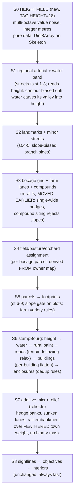

# MAPGEN V4 — height-first pipeline, micro-scale rules, bocage coherence

Owner feedback after playtesting v3 (which landed 2026-07-28, `lane-v3-mapgen`):
maps read well zoomed out; zoomed in, the micro-scale fabric (yards, hedges,
fields, farm layout, hills, town edges) breaks down. V4 replaces the
decoration-last elevation model with a height-FIRST pipeline and turns each
owner complaint into a concrete, testable micro-rule.

Every claim below was verified against the tree at HEAD (2026-07-28) by reading
the generator end to end and by instrumenting it (vitest probes + ASCII dumps +
`scripts/check-overlap.mjs` + `scripts/verify-claims.mjs`, seeds 1, 2, 3, 7, 13
at 320x240).

---

## 0. Confirmed root causes — one per owner complaint

| # | Complaint | Verdict | Root cause (file:line) |
|---|---|---|---|
| 1 | Yards/streets/orientations don't make sense zoomed in | **Confirmed, three mechanisms** | (i) garden rects swallow wings/étables (see #2); (ii) rural farms use hardcoded orientations (see #5); (iii) the fringe étable's `frontage` faces the STREET though it stands at the plot rear (footprints.ts `et` emit, `frontage: front`). Frontage-to-street itself works for plot buildings (`frontFace`, footprints.ts:115, doors on the street face) — that rule exists and holds. |
| 2 | Houses/backyards generated on top of each other; overlapping wall runs | **Confirmed** | Garden rect = full plot width × full tail (footprints.ts `gardens.push(localRect(p, 0, p.setback+bd, p.w, tail))`) and INCLUDES the L-wing and étable tiles (by design "wings stand INSIDE it", but `tail[]` then marks floor tiles as garden, enclosures.ts:88-93). `check-overlap.mjs`: seed 2 townhouse@188,132 3×5 ⇔ garden@188,132 7×8; seeds 3, 7, 13 similar (barn ⇔ garden). Plus: back-to-back plots of differing depth write TWO parallel 2 m rear walls 1-3 tiles apart (enclosures.ts garden rear pass writes per-garden with no cross-plot dedup) — measured 580-820 adjacent parallel WALL edge pairs per seed. No building⇔building overlap exists (both emitters throw on `occ`). |
| 3 | Hedges double-wide | **Confirmed** | `bocage()` (rural.ts:317-330) marks a tile hedge when ANY 4-neighbour has a different Voronoi owner — so BOTH tiles flanking a parcel boundary are marked. Measured: 55-60 % of hedge runs ≥8 tiles are 2-tile-wide bands (seeds 1,2,3,7, 'open'). `hedgeBanks` (relief.ts:113) then lifts the hedge tile AND a shoulder, visually thickening the band further. (A delegated audit claimed single-wide from a superficial code read; the empirical run wins.) |
| 4 | Fields scattered, not bounded by hedges | **Confirmed** | Field pass (rural.ts:434-441) paints 4-7 random axis-aligned rects over any `plantable` grass, with zero reference to the bocage owner map. Measured: 88 % of field tiles have no hedge neighbour; 209-323 field tiles per seed cross parcel boundaries. ASCII dumps show hedge lines running through field blocks. |
| 5 | Isolated farmhouses all identical | **Confirmed** | `placeFarms` (rural.ts:78-128) emits ONE layout: logis north (7-8 × 5-6), yard middle (always `open: 'e'`, gate east), grange south (8-11 × 5-6); logis `frontage: 's'`, grange `frontage: 'n'`, barn door always width 2 mid-span. Only dimensions jitter. No rotation, no L-shapes, no 3-mass variant, no orientation to the lane. |
| 6 | Hills are circular stepped mounds | **Confirmed** | `elevateBourg` (mapgen.ts:341-368) places 2-4 cosine domes, r 8-19, peak 3-8, `Math.cos` profile — perfectly circular by construction, placed uniformly at random outside the flat mask. |
| 7 | Town sits on a raised/sunken SQUARE of flat terrain | **Confirmed mechanism** | `bourgFlatMask` (mapgen.ts:370-408) is `zoneOf` = R_env+6 AXIS-ALIGNED RECTANGLE (+ a 45×45 faubourg square), binary. Every elevation writer hard-skips it (`elevateBourg` :353, `undulate` relief.ts:171, `hedgeBanks` :126, `sunkenLane` :209, `embankment` :283). Result: elev steps from full relief height to 0 exactly on a screen-aligned rectangle — the town reads as a sunken square moat / raised plateau depending on surroundings. |
| 8 | Wants sequential chunk stages, height first | **Design accepted, with one amendment** | Height today comes LAST (stage 13 + relief after stamping). V4 generates the heightfield FIRST as pure plan data and lets streets/lanes/footprints read it. Amendment: the pure-plan / stamp split (plan.ts) stays — height becomes plan data riding on the Skeleton, not a GameMap pass. This keeps the two-phase architecture that the whole determinism regime is built on. |

---

## 1. Non-negotiables carried forward (v3 law, unchanged)

- Seeded rng only (mulberry32); ONE shared-stream draw per attempt
  (`rng.int(0x7fffffff)`, mapgen.ts:195); every stage on `subStream(base, TAG)`;
  tags only ever APPENDED (streets.ts:18-33). V4 appends `TAG.HEIGHT = 18`
  (17 is SIGHTLINE; 20-29 are relief's).
- No Math.hypot / exp / pow anywhere in generation. Bilinear value noise uses
  `+ − × ÷` and Math.round only (relief.ts `lerp2` is the precedent and is reused).
- Draw-count discipline: lattice/noise draws are a pure function of map size
  (undulate's lattice precedent, relief.ts:155-162). Slope-informed decisions in
  existing stages must NOT add draws — reuse the stage's existing draw and
  post-decide deterministically (see §3.4).
- `validate()` gate and the 8-attempt reroll loop unchanged (mapgen.ts:188-195,
  862+). Fingerprint pins re-baseline per task via `scripts/fp.mjs` (v3 §3
  precedent); PRE_RELIEF rows stay hand-pasted literals, never `vitest -u`.
- Sim surface is additive only: terrain keys, hEdges/vEdges + tops, elev
  (integer metres), stories, buildingId, stairs, bridges, crossings.
- Perf: bourg 40 ms mean / 90 max at 320x240. Noise field + feather + blending
  budget: ≤ 6 ms (measured headroom: bourg currently 18 ms mean).

---

## 2. The V4 stage order

What each stage consumes from prior stages:

| Stage | Consumes | Produces |
|---|---|---|
| S0 | seed, w, h, profile.height | `sk.height: Uint8Array` (integer metres, pre-flatten) |
| S1 | height (arterial drift bias; water valley) | road spine bitmap, water band, R_env, place |
| S2 | height (branch-side bias), resv | full road bitmap, landmark reservations |
| S3 | height (compound slope rejection), roads, resv | hedge mask (1-wide), bocage owner map, farm compounds, farm lanes |
| S4 | bocage owner map | per-parcel land-use assignment (crop/pasture/orchard) |
| S5 | height (plot slope gate), roads, resv | plots, buildings, gardens, venelles, compounds |
| S6 | everything above | the GameMap (terrain, edges, elev, stories, ids) |
| S7 | GameMap + feather weight field | elev deltas: banks, sunken lanes, embankment |
| S8 | finished map | sightline openings, objective-driven interiors |

Two structural moves vs v3: (a) rural fabric (hedges/lanes/compounds/fields)
moves BEFORE parcels/footprints in the plan phase — it is pure geometry, only
its paint pass waits for the GameMap, so the move is free and fields can derive
from the hedge grid without a second pass; (b) elevation is generated first and
*shaped* by later stages instead of being poured over the finished map.

---

## 3. Micro-rules

### 3.1 Height (complaints 6, 7, 8a)

**New module `src/sim/bourg/height.ts`.** Pure plan data, unit-testable against
a bare array like relief.ts is against a hand-built GameMap.

- **R-H1 · Noise field.** 3-octave integer value noise on lattices of 96, 48
  and 19 tiles (reuse `lerp2` from relief.ts — move it to height.ts and import
  it back). Lattice values drawn in full before any tile is sampled (draw count
  = pure function of map size). Per-kind amplitude from a new KindProfile field
  `height: { amp: number }` appended to the interface: bourg/road 4, open 6,
  river/bridge 6, woods 7. `elev(x,y) = round(amp * (0.55·L96 + 0.30·L48 +
  0.15·L19))` — smooth, no terraces of identical radius, no circles.
  `elevateBourg` and its cosine domes are DELETED; `undulate()` is retired (the
  noise field subsumes it; `ReliefProfile.undulation` is removed).
- **R-H2 · Applied at every map size ≥ 60x40.** The 240x180 relief gate
  (RELIEF_MIN_W/H) continues to gate only the additive micro-relief
  (banks/rail/sunken). The 160x120 default and 60x40 floor maps gain smooth
  height — their pins re-baseline (§5). With `opts.relief === 'none'` the field
  is generated (draws happen, stream stable) then zeroed: one code path,
  relief-off maps stay flat and comparable.
- **R-H3 · Town feather, not a mask.** The binary `bourgFlatMask` becomes a
  Q8 **weight field** `townW[i] ∈ [0,256]`: start from the same binary region
  (zoneOf + compounds dilated 2 + occ dilated 1 + free-wall tiles), then two
  integer box-blur passes of radius 4 (separable, `+ − ÷` only). Every
  elevation writer multiplies its delta by `(256 - townW[i]) >> 8` instead of
  hard-skipping. The town core stays flat (weight saturates at 1 well inside
  the built area); the elevation ramps in over ~8 tiles OUTSIDE the rectangle —
  the square cliff is gone by construction. Relief passes take the weight field
  where they took `flatZone`.
- **R-H4 · Road relaxation (terrain-following roads).** After roads are
  stamped: two in-place scan-order passes over road tiles,
  `e[i] = clamp(e[i], minRoadNbr - 1, maxRoadNbr + 1)` over 4-neighbour road
  tiles, then the verge rule (a non-road tile 8-adjacent to road clamps its
  delta vs the adjacent road to ±1 — today's undulate feather, moved here).
  Roads follow the ground; no step > 1 m along a road; verges are ditches,
  not walls.
- **R-H5 · Building/compound flatten.** Per structure (including church group
  and halt): `e0 = min` of height over the footprint; write `e0` to the
  footprint + 1-tile border, then blend linearly from `e0` to the field height
  over the next 2 tiles (integer ramp). Compound yards flatten with their
  buildings (the yard rect joins the building's flatten region — a wall
  straddling a 2 m step is the LOS seam bourgFlatMask existed to prevent).
  `stampHalt`'s levelling (relief.ts:530+) is the precedent and is subsumed.
- **R-H6 · River valley.** On water kinds, after the band is placed (S1): for
  each tile, `d` = Chebyshev distance to the band capped at 5;
  `height[i] += (5 - d) * valleyAmp` with valleyAmp 1 — the plain rises gently
  away from the river, which sits at the local minimum. No below-datum
  representation is needed (H2 precedent: raise the world, never dig).
- **R-H7 · Slope gates (later stages READ height).**
  - placeFarms: reject a candidate rect when `max - min` of height over the
    dilated rect > 2 (same 40-try loop, draw count unchanged — the rejection
    consumes the same draws it does today).
  - Plot frontage: skip the building (garden/orchard only) when height range
    over the plot's build band > 3. Reuses the existing per-plot skip path;
    no new draws.
  - Farm lanes: `carve` rejects a dogleg whose total ascent exceeds 8 m and
    tries the other component order first (both orders are pure functions of
    the endpoints — no draws).
  - Embankment/sunken lanes/banks: unchanged, still additive over the field
    (max-writes, never set-except-terrace).

### 3.2 Hedges (complaint 3)

- **R-G1 · Single-wide rule.** In `bocage()`, a tile is hedge iff its EAST or
  SOUTH 4-neighbour has a different non-negative owner (replacing "any
  4-neighbour"). The boundary is then the west/north tile of each owner change
  only — a connected 1-tile-wide line (a subset of today's band). Corner
  point-contacts need no filler: astar's no-corner-cutting rule
  (path.ts:107-114) already makes a diagonal squeeze between two hedge tiles
  impassable, so no leak opens.
- **R-G2 · Banks stay asymmetric, one shoulder.** `hedgeBanks` unchanged in
  rule but now operates on 1-wide lines: hedge tile lifted to ≥1 m, one
  grass/field shoulder on the lower-hash flank. The visual band is hedge(1) +
  shoulder(1) = 2 tiles of *height*, 1 tile of *hedge* — the owner's "more
  spread out".
- **R-G3 · Cell retune.** Bigger pastures: bocageCell bourg 22→26, road 22→24,
  open/river/bridge 20→24, woods 32→34 (KindProfile values). Site jitter becomes
  derived instead of absolute: `cx*cell + 3 + r.int(cell - 12)` (was
  `3 + r.int(16)` regardless of cell), preserving the minimum 6-tile site
  separation. Gates unchanged (2-3 tiles punched per shared edge ≥ 6).

### 3.3 Fields (complaint 4)

- **R-F1 · Land use derives FROM the parcel grid.** `bocage()` already builds
  `owner[]` (site index per tile). S4 draws ONE assignment per SITE in scan
  order (sites = cols×rows — a pure function of map size and cell, so the draw
  count is stable whether or not a site owns any plantable tile; the lattice
  precedent): `k = r.int(100)`; crop if `k < cropPct`, orchard if
  `k < cropPct + orchPct`, else pasture. New KindProfile field
  `fieldMix: [cropPct, orchPct]` — bourg [35, 10], open [45, 10], road [40,
  10], river/bridge [45, 10], woods [15, 5].
- **R-F2 · Paint.** In paintRural's field/orchard phase: a plantable tile
  outside the town zone becomes 'field' iff its owner's assignment is crop;
  orchard rows (existing every-2-tile stagger) iff orchard; untouched grass
  otherwise. A field now IS a hedged enclosure's interior by construction —
  it can never cross a hedge, because the owner map changes across every
  hedge. The near-town standalone orchard rects (rural.ts:425-433) stay as-is
  (they're inside the zone, disjoint from bocage).
- **R-F3 · The owner map must reach paintRural.** `Rural` gains `owner:
  Int32Array` and `landUse: Uint8Array` (per site). Additive plan data; no
  GameMap surface change.

### 3.4 Overlap exclusions (complaint 2)

- **R-O1 · tail[] never marks floor.** In enclosures.ts's tail-marking loop
  (:88-93), skip tiles with `fp.occ` set. Wings and étables still stand inside
  the garden RECT (perimeter walls close around them — putWall already refuses
  building-owned edges), but the lateral-wall logic no longer reads a building
  as a garden, and `check-overlap.mjs`'s building⇔garden rect overlap is
  resolved at the data level: gardens.push stores the rect MINUS building
  intersection for measurement purposes (keep the wall perimeter on the full
  plot tail).
- **R-O2 · One rear wall between back-to-back gardens.** Garden rear pass:
  write the WALL_HIGH rear edge only when the outside tile is NOT another
  garden's; when it is, write only if this garden's rear line is deeper
  (farther from its own street) than the neighbour's, ties to the lower
  plotIndex. Exactly one wall per inter-garden boundary, zero parallel runs.
  Same rule on lateral faces between two gardens (today's top-1 logic keeps
  the wall; add the same first-writer-wins guard for the 1-tile-apart case).
- **R-O3 · Étable orientation.** The fringe étable's `frontage` and door face
  the HOUSE (opposite of the plot front), not the street — it stands across
  the yard at the plot rear. One-line change at the `et` emit (footprints.ts).
- **R-O4 · Compounds stay clear.** placeFarms' `clearOf` (dilated 2) already
  prevents compound/parcel-wall overlap (measured: none on 5 seeds). Keep.

### 3.5 Farm variety (complaint 5)

All inside `placeFarms`, draws restructured but constant-count per attempt
(draw the layout roll FIRST, then dimension draws in a fixed order):

- **R-V1 · Four orientations.** `rot = r.int(4)`: the logis-yard-grange stack
  runs N→S (today), S→N, E→W or W→E. The yard's `open` face rotates with the
  stack.
- **R-V2 · Orient to the lane.** Override: the yard's `open` face points toward
  the nearest arterial tile (`(x, sk.roadY[x])`, Chebyshev — the farm lanes
  grow from the arterial, so the gate faces its approach). This is a
  post-decision on data already drawn — zero extra draws.
- **R-V3 · L-shaped logis.** p 0.35: the logis gains a rear wing via the
  existing `parts[]` mechanism (3-4 × 3-4, abutting, never overlapping —
  stamp.ts's assertShape enforces it). Same stream position: the roll is one
  `r.next()` at a fixed point; wing dimensions drawn only when taken... NO —
  draw them always, use them when taken (stream stability).
- **R-V4 · 3-mass variant.** p 0.25: add an étable (4-5 × 3-4) on the yard's
  third side; the compound wall then closes the fourth (today's wall-all-faces
  pass already handles whichever faces buildings don't cover).
- **R-V5 · Wider size ranges.** logis 6-9 × 4-6, grange 7-12 × 4-7, yard 4-8
  deep — same `base + r.int(span)` draw shape, retuned spans.

### 3.6 Orientation audit (complaint 1)

| Emitter | Rule today | V4 rule |
|---|---|---|
| Plot frontage | front door + `frontage` on street face (works) | unchanged |
| Rear door | on rear face, jittered or porte-cochère | unchanged |
| Fringe étable | `frontage: front` (street!) — wrong | **faces the house** (R-O3) |
| fillInterior cours | all doors face the yard (works) | unchanged |
| Rural farms | hardcoded s/n, gate always east | R-V1/R-V2 |
| Market island | alternating faces by index | unchanged (island convention, reads fine) |
| Church | door faces the place | unchanged |
| Halt | faces its platform | unchanged |
| Gardens | rect includes wing/étable tiles | R-O1 |

---

## 4. Determinism & fingerprint plan

- **Tags:** append `TAG.HEIGHT = 18` (streets.ts TAG table). 19 reserved.
  Relief's 20-29 unchanged. No renumbering anywhere.
- **Draw stability rules (all new code):** lattice draws are size-pure
  functions; per-site land-use draws are site-count-pure; slope gates reuse
  existing draws; farm layout draws are fixed-order and unconditional.
- **Pins re-baselined, per task (fp.mjs → hand-paste):**
  - bourg.test.ts:1372-1445 (bourg×4 incl. two relief-off literals, road×2,
    open×2, woods×2, river×2, bridge×2)
  - mapgen.test.ts:56-57 (160x120), :71-74 (furnished open + bourg)
  - relief-wiring.test.ts PRE_RELIEF rows (8 seeds × 6 kinds) — the table's
    MEANING (relief stage purely additive over pre-relief geometry) survives:
    with `relief:'none'` the heightfield is zeroed (R-H2), so relief-on vs
    relief-off still isolates the additive passes.
  - Controls that must NOT move except when their task says so: suite-wide
    greps after each task; any pin outside the task's listed set that moves is
    a stream leak — stop and find it.
- **Balance:** LOS reads elev and V4 changes elev EVERYWHERE (noise field,
  road relaxation, town feather). **Flag: one `scripts/.balance-baseline`
  re-record after the final task, sequenced exactly as v3 P7 did it — do not
  race it with other chains.** Also a full sweep reshoot (all FORCE_KIND
  slots now exist, seeds 1-13) for the art gate.

## 5. Validation & perf

- `validate()` unchanged; the 8-attempt loop absorbs the (small) extra
  rejection rate from slope gates. Assert first-attempt reject rate stays
  within existing per-kind thresholds (perf.test.ts pattern).
- New structural battery entries (bourg.test.ts): no 2-wide hedge band
  (scan: no hedge run ≥8 with >70 % same-side flank — the probe written for
  this audit, seeds 1-13); every field tile's 4-neighbourhood contains ≥1
  hedge OR is inside a parcel assigned crop (R-F1 invariant); zero
  building⇔garden `tail[]` marks; farm layout distribution over 40 seeds
  (all four rotations occur; ≥20 % L-shapes); elev range inside town core ≤ 1
  and no axis-aligned step > 2 m along the zone boundary transect.
- Perf: height gen = 3 lattices + 3 lerp2/tile ≈ 1.5 ms at 320x240; feather =
  2 separable box blurs ≈ 1 ms; road relax + building flatten < 1 ms. Budget
  holds (bourg 18 ms mean today, cap 40).

---

## 6. Quick wins (shippable before the big reorder)

Ordered by value/effort. Each is independent; each re-baselines only the pins
it touches (all kinds for Q1/Q2 — hedges and fields exist on every kind).

- **Q1 · Hedge single-wide + cell retune (R-G1..G3).** rural.ts only. Kills
  the double-wide look AND spreads fields out in one change. ~1 day.
- **Q2 · Parcel-derived fields (R-F1..F3).** rural.ts + profile.ts. Fields
  align to hedged enclosures. Depends on Q1 sharing `bocage()` (land
  together). ~1 day.
- **Q3 · Farm variety (R-V1..V5) + étable orientation (R-O3).** rural.ts +
  footprints.ts. The most visible zoomed-in win after Q1. ~1 day.
- **Q4 · Overlap exclusions (R-O1, R-O2).** enclosures.ts + footprints.ts.
  ~0.5 day.

Q1-Q4 deliberately touch ONLY rural/footprints/enclosures/profile — no
elevation semantics change, no balance re-record, sweep reshoot optional.

## 7. Task breakdown (sequential sim lane; each ≤ 3 files, ≤ 15 turns)

| Task | Files | Determinism impact | Pins re-baselined | Tests | Size |
|---|---|---|---|---|---|
| **V4-P1** Quick wins Q1+Q2 | rural.ts, profile.ts, (Rural type) plan.ts | TAG.ORCHARD/RURAL draw counts change | all kinds' geometry pins; PRE_RELIEF all rows | hedge-width probe; field-in-parcel invariant | M |
| **V4-P2** Quick wins Q3+Q4 | rural.ts, footprints.ts, enclosures.ts | farm draw restructure (constant count) | all kinds (farms exist on all) | farm distribution; zero tail-on-floor; one-wall rule | M |
| **V4-P3** height.ts module + noise + feather (no consumers yet) | height.ts (new), streets.ts (TAG.HEIGHT=18), relief.ts (export lerp2) | none — module + dead wiring only | none (prove: suite green, zero pin edits) | unit: determinism, integer range, feather weights | S |
| **V4-P4** Wire height in: delete domes/undulate, feathered townW, road relax, building flatten | mapgen.ts, plan.ts/stampBourg path, relief.ts | every map's elev changes | **all pins incl. 160x120 + furnished**; PRE_RELIEF | town-core flatness; no square transect step; road grade ≤1 | L |
| **V4-P5** Terrain-following stages: arterial bias, lane slope rule, compound/plot slope gates, river valley | streets.ts, rural.ts, height.ts | stage decisions change, draw counts don't | all kinds' geometry pins; PRE_RELIEF | slope-gate rejections bounded; valley profile present | M |
| **V4-P6** Re-baseline + coordination | sweep reshoot, `.balance-baseline` re-record, docs/INDEX entry | — | final re-freeze audit | full suite + sweep contact sheet review | S |

**RISK: V4-P4 is the irreversible centre of the chain.** Blast radius: every
fingerprint pin on every kind, the art sweep baseline, and the combat balance
baseline (LOS is elevation-driven). Rollback difficulty: low in git (the chain
is sequential commits), high in review cost (112-shot reshoot + balance
re-record must be redone if P4 is reverted after P5/P6 land). Mitigation: P3
lands the module dark with zero pin movement as the control; P4 is one commit
that flips consumption.

**RISK: slope gates (P5) can starve small maps of buildable plots.** Blast
radius: reroll rate on 'open'/'woods' hamlets. Rollback: trivial (gate
thresholds are constants). Mitigation: reject-rate assertion per kind in the
same task.

## 8. Open risks / unknowns

1. The audit measured 1,476-4,199 non-zero elev tiles INSIDE the flat-zone
   rectangle on some seeds despite every writer hard-skipping it — unresolved
   (likely a probe reconstruction error, possibly a real bleed). P3's
   instrumentation must settle it before P4 deletes the mask. If real, it is
   an existing LOS bug and gets its own decision-log entry.
2. Multi-octave noise at amp 6-7 on 'open' interacts with the embankment's
   absolute terrace (relief.ts writes SET elevations) — the terrace invariant
   (bank exactly 1 m below inward neighbour) survives, but the embankment may
   sit in a noise valley and read as a causeway. Accept; eyeball in P6 sweep.
3. Field-per-parcel on 'woods' (canopy 58 %): most parcels are under trees
   and never paint — harmless by construction (plantable gate), but the
   clearings may read as fields. Accept.
